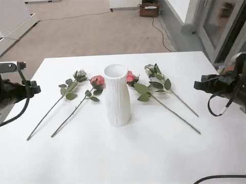
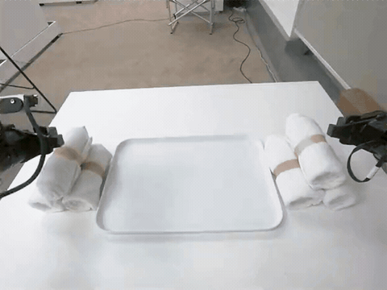
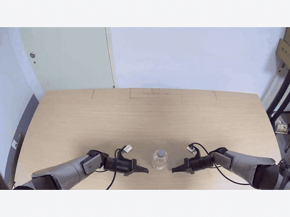
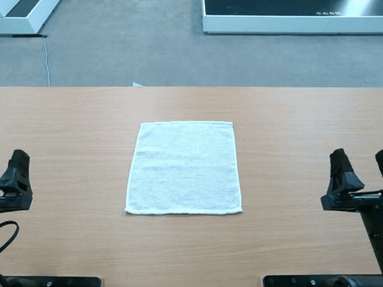
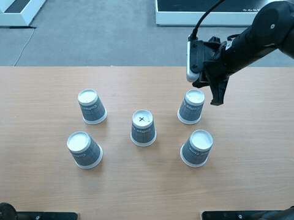
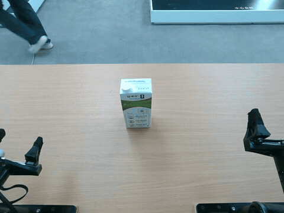
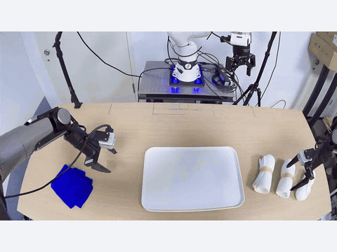
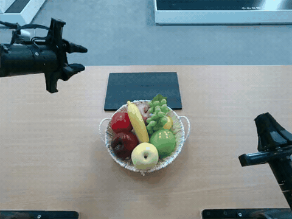

# Agentic Orchestration Policy

  

| Arrange four flowers in a vase | Build a six-roll towel pyramid |
| :---: | :---: |
|  |  |

| Unscrew a bottle cap | Fold a towel |
| :---: | :---: |
|  |  |

| Stack cups onto the one marked X | Hold a milk carton with both hands |
| :---: | :---: |
|  |  |

| Clean a spill and arrange towels | Carry a loaded basket with both arms |
| :---: | :---: |
|  |  |

**Framework release coming soon.**
